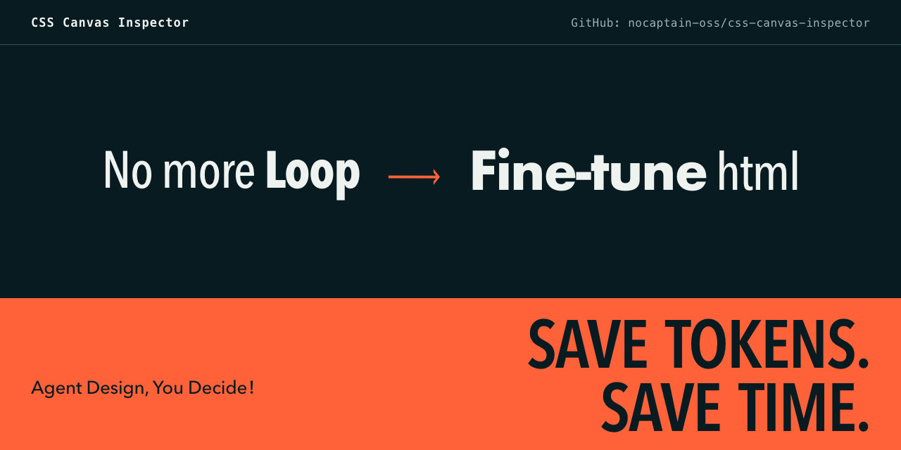

[English](README.md) · 简体中文



# CSS Canvas Inspector

**代码设计的视觉品控工具。**

Agent 能写 HTML/CSS，却看不见成品的问题；人看得见问题，往往只能用截图和一句句 prompt 把像素意图传回去。CSS Canvas Inspector 把这段来回拉扯变成一次直接编辑：在浏览器里选中元素、修改真实 CSS，再把编辑后的 HTML 交还给 agent。

它面向固定尺寸的代码设计产物，例如封面、海报、社交卡片、幻灯片和缩略图。你可以在同一套本地界面里做 A/B 对照、逐页审阅多画布 deck，并导出 JPG、PNG、动画 WebP 或编辑后的 HTML。

没有构建步骤。启动器只依赖 Python 标准库，会把项目与本工具放在同一个本地源下运行。它不会启动 Vite、Next.js 或其他后端，也不会替 agent 自动改写源文件。

## 适用场景

- 人类直接调整 agent 生成的固定尺寸 HTML。
- 用 A/B 双画布比较两种视觉方案。
- 用一个 HTML 文件里的多个 `.poster` 节点逐页做交付审阅。
- 把浏览器里的修改下载成 HTML，交给 agent 作为下一轮基线。
- 为代码设计产物导出多种图片格式，做尺寸、排版与像素级品控。

## 工作流

1. 让 agent 生成一个固定尺寸的 HTML 画布。
2. 启动 CSS Canvas Inspector，打开这个 HTML。
3. 选中元素，直接修改排版、字号、间距、颜色和位置。
4. 下载编辑后的 HTML，交给 agent 回读。
5. 验收后从当前画布导出 JPG、PNG 或动画 WebP。

浏览器里的编辑会按本地源和 `storage` 命名空间自动保存。源文件在下载 HTML 之前保持不变。

## 安装

Skill 目录是完整的运行时。安装时要把整个目录复制进去，包括 `index.html`、`blank.html`、`src/`、`scripts/` 和 `agents/`：

```bash
git clone --depth 1 https://github.com/nocaptain-oss/css-canvas-inspector /tmp/css-canvas-inspector
mkdir -p ~/.agents/skills/css-canvas-inspector
cp -R /tmp/css-canvas-inspector/skills/css-canvas-inspector/. \
  ~/.agents/skills/css-canvas-inspector/

python3 ~/.agents/skills/css-canvas-inspector/scripts/open_inspector.py \
  /absolute/path/to/poster.html --check
```

Codex 可以使用 `~/.codex/skills/`，Claude Code 可以使用 `~/.claude/skills/`。自检必须输出 `Runtime: OK`。只复制 `SKILL.md` 和 `scripts/` 是不完整安装。

## 打开一个项目

```bash
python3 ~/.agents/skills/css-canvas-inspector/scripts/open_inspector.py \
  /absolute/path/to/poster.html \
  --project /absolute/path/to/project \
  --export-width 1280
```

`--project` 指定本地静态服务器的项目根目录，默认取最近的 `.git`、`package.json`、`pyproject.toml`、`Cargo.toml` 或 `go.mod` 目录；找不到时使用 HTML 所在目录。如果 HTML 引用了更上层目录的本地资源，显式传入项目根。

尺寸不传时会自动读取画布元数据或固定尺寸根节点。响应式页面最好声明目标尺寸：

```html
<meta name="canvas-width" content="1080">
<meta name="canvas-height" content="1440">
```

## 多格式输出

| 输出 | 用途 |
|---|---|
| JPG | 默认位图导出，适合含照片和复杂底纹的成品 |
| PNG | 适合文字、界面和需要清晰边缘的卡片 |
| 动画 WebP | 页面能按 `frames` 与 `frameParam` 稳定渲染单帧时，可导出动画 |
| 编辑后的 HTML | 保留浏览器里完成的修改，供人验收或交回 agent |

导出宽度可配置，默认是 `1280px`。动画 WebP 只导出当前激活的画布；多画布 deck 模式请分别导出 JPG 或 PNG。

## 功能

- 点选画布元素，修改宽高、字号、字重、行高、字距、颜色、对齐、外边距和内边距。
- 使用相对 X/Y 微调位置，或切换到画布左上角为 `0,0` 的绝对坐标。
- 输入额外 CSS 属性，直接编辑混合行内内容里的文本节点。
- 复制、删除、撤销和重做元素。
- 从 `5%` 到 `300%` 缩放，配合适配窗口、100% 与双轴滚动。
- 双画布比较前两个 variant，橙色外框标出当前编辑目标。
- 多画布模式把每个匹配节点变成独立页面，分别审阅和导出。
- 下载包含编辑结果的 HTML，并保留源文件作为基线。

## 接入 agent 工作流

完整的项目接入约定见 [INTEGRATION.zh.md](INTEGRATION.zh.md)。最简单的规则是：

```markdown
生成固定尺寸 HTML 后，用 css-canvas-inspector 打开它，等待人类在浏览器里审阅。
人类完成后，读取“下载 HTML”的产物，对比源文件并回写差异，再从新基线导出图片。
```

工具提供的是人和 agent 共用的可视审阅界面。截图可以作为机器自检的辅助，不能替代人对真实画布的判断。

## 限制

- 启动器是静态服务器，不代理后端接口，也不执行服务端模板。
- 浏览器里的编辑只保存在本地存储；必须下载 HTML 才能交给 agent 回读。
- 跨域图片或字体可能保留外链，并影响精确导出。需要稳定导出时，把资源放进项目根目录。
- `html2canvas` 对复杂混合模式、滤镜和部分渐变只能近似渲染。需要完全一致的 CSS 效果时，请使用 HTML 输出。
- 不同项目可能运行在不同本地端口，因此拥有独立的编辑历史。
- 这是固定尺寸 HTML 的检查器，不是通用拖拽建站器，也不是 PSD/位图编辑器。

## 许可

MIT。内置的 `html2canvas` 许可证位于 `skills/css-canvas-inspector/src/vendor/html2canvas.LICENSE.txt`。
